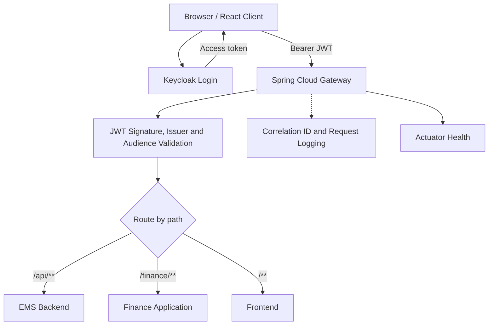
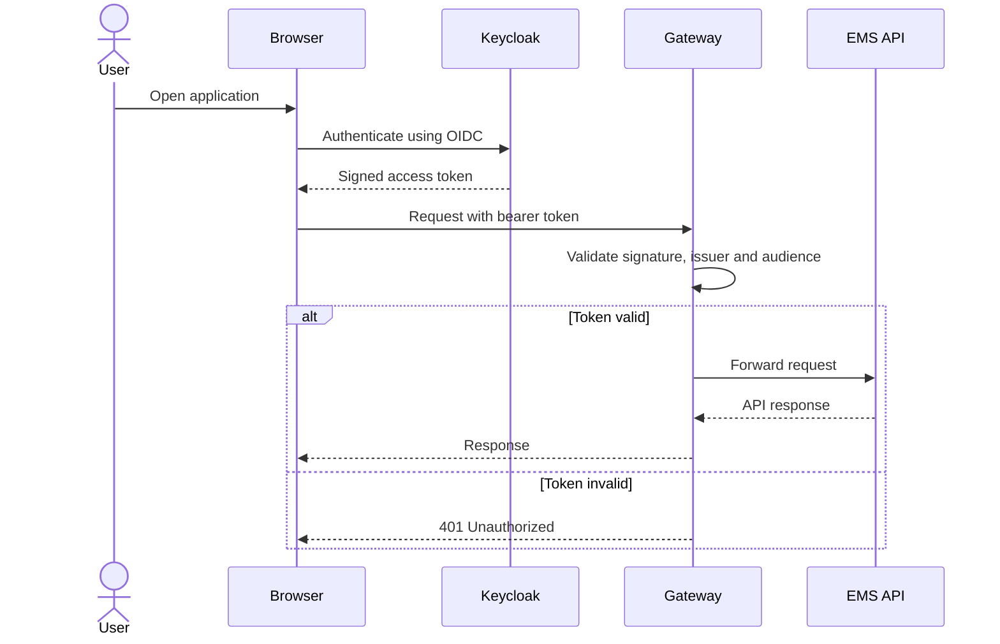

# EMS API Gateway

A reactive API gateway for the Employee Management System ecosystem, built with **Java 21, Spring Boot, Spring Cloud Gateway, Spring Security, and Keycloak**.

The gateway provides a browser-facing entry point, routes requests to application services, and validates Keycloak-issued JWT access tokens before protected API traffic reaches the backend.

> **Important:** The checked-in Docker Compose environment is for local development. It starts stub upstream services and a development Keycloak realm; it is not a production deployment configuration.

## Overview

The local Compose setup includes the gateway, Keycloak with a PostgreSQL database, and lightweight HTTP stub services for the EMS API, finance application, and frontend. The stubs allow routing to be exercised before connecting real applications.

## Responsibilities

- Route incoming requests to configured upstream services.
- Validate bearer JWTs using Keycloak's issuer and JWK set.
- Enforce the expected token audience (`ems-api`).
- Convert Keycloak realm roles into Spring Security authorities.
- Apply CORS rules and deduplicate CORS response headers.
- Add correlation identifiers and log request metadata.
- Expose health and info endpoints through Actuator.

## Architecture



### Authentication flow



## Routing

Routes are configured in `src/main/resources/application.yaml`.

| Incoming path | Upstream | Behavior |
| --- | --- | --- |
| `/api/**` | `EMS_API_URL` | Forward path unchanged |
| `/finance/**` | `FINANCE_URL` | Remove first path segment using `StripPrefix=1` |
| `/**` | `FRONTEND_URL` | Catch-all frontend route with lower precedence |

The default local Compose setup points these routes to stub containers. Override the upstream URLs to connect real services.

## Technology stack

| Area | Technology |
| --- | --- |
| Language | Java 21 |
| Framework | Spring Boot 4.1.0 |
| Gateway | Spring Cloud Gateway Server WebFlux |
| Security | Spring Security OAuth2 Resource Server |
| Identity provider | Keycloak 26.8 |
| Operations | Spring Boot Actuator |
| Build / containers | Maven Wrapper, Docker, Docker Compose |
| Tests | Spring Boot Test, Spring Security Test |

## Getting started

### Prerequisites

- Git
- Docker Engine and Docker Compose plugin
- Java 21 (only required when running outside Docker)

### 1. Clone

```bash
git clone https://github.com/robinmwaniki/ems-gateway.git
cd ems-gateway
```

### 2. Start the local stack

```bash
docker compose up --build
```

The first startup builds the gateway image, starts the Keycloak database, imports the `ems` realm, and starts the stub upstream services.

### 3. Local endpoints

| Service | URL |
| --- | --- |
| Gateway | [http://localhost:9000](http://localhost:9000) |
| Keycloak | [http://localhost:8180](http://localhost:8180) |
| Gateway health | [http://localhost:9000/actuator/health](http://localhost:9000/actuator/health) |

Stop the stack with `docker compose down`. To reset the local Keycloak database and re-import the realm, run `docker compose down -v` followed by `docker compose up --build`. Removing volumes permanently deletes local Keycloak data.

## Configuration

The gateway reads environment variables; defaults in `application.yaml` target the local Compose setup.

| Variable | Purpose |
| --- | --- |
| `GATEWAY_PORT` | Gateway port; defaults to 9000 |
| `EMS_API_URL` | EMS backend upstream URL |
| `FINANCE_URL` | Finance application upstream URL |
| `FRONTEND_URL` | Frontend upstream URL |
| `KEYCLOAK_ISSUER_URI` | Expected JWT issuer |
| `KEYCLOAK_JWK_SET_URI` | Keycloak public signing-key endpoint |
| `CORS_ALLOWED_ORIGINS` | Comma-separated allowed browser origins |

Configure production values through the deployment platform's secret and configuration manager.

## Authentication and authorization

The gateway is an OAuth2 Resource Server. It validates JWT signatures using Keycloak's signing keys and checks the configured issuer and audience. The expected API audience is `ems-api`.

The local realm defines these roles:

| Role | Intended responsibility |
| --- | --- |
| `ADMIN` | Full EMS administrative access |
| `HR_MANAGER` | Employee and department administration |
| `EMPLOYEE` | Employee self-service |

A role converter maps Keycloak realm roles into Spring Security authorities. The downstream API must still enforce authorization for its own resources; gateway validation alone is not sufficient.

## Observability

The project includes correlation-ID and request-logging filters, Actuator health/info endpoints, and graceful shutdown configuration. Avoid logging access tokens, passwords, or other sensitive request data.

## Tests

**macOS / Linux**
```bash
./mvnw test
```

**Windows**
```powershell
.\mvnw.cmd test
```

Tests cover gateway routes, correlation-ID behavior, Keycloak role conversion, and security configuration.

## Security notes

- The Compose setup is strictly for local development.
- The checked-in realm import contains development-only test accounts and credentials. Never reuse those credentials or deploy the realm file unchanged.
- Replace development defaults with strong secrets outside local development.
- Use HTTPS in deployed environments and restrict CORS to trusted frontend origins.
- Use a production Keycloak realm with secure client settings and carefully managed users and roles.
- Do not expose management endpoints publicly without access controls.
- Keep downstream authorization enabled.

## Related repositories

- [EMS Backend](https://github.com/robinmwaniki/employment-management-system)
- [EMS Frontend](https://github.com/robinmwaniki/ems_frontend)
- [Student Finance Manager](https://github.com/robinmwaniki/Student-finance-manager)

## License

No license file is currently declared. Unless a license is added, standard copyright restrictions apply.

## Maintainer

**Robin Mwaniki** · [GitHub](https://github.com/robinmwaniki)
